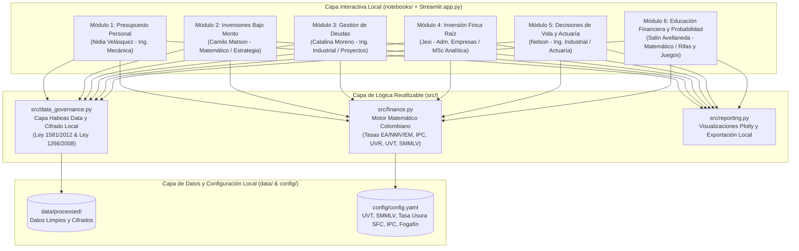
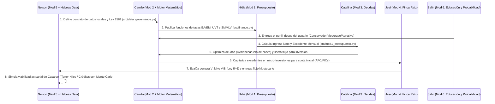

# Especificación Funcional y Casos de Uso: Sistema Local de Asesoría Financiera e Inversiones OED (Colombia)

> [!IMPORTANT]
> **Alcance Regulatorio en Colombia (Superintendencia Financiera de Colombia - SFC):**  
> Este software se diseña como una **herramienta local de educación financiera, analítica personal y simulación matemática de apoyo a la toma de decisiones**. Conforme al **Decreto 2555 de 2010** y el **Estatuto Orgánico del Sistema Financiero (EOSF)**, la aplicación **no capta recursos del público** (Art. 316 del Código Penal) ni ejecuta órdenes bursátiles directas, e incluye descargos de responsabilidad (*disclaimers*) y perfilamiento de riesgo obligatorio antes de mostrar escenarios de inversión.

---

## 1. Visión General y Arquitectura Técnica (100% Local en Python)

El sistema **Asesor Financiero OED (`asesor_inversiones_oed`)** es una aplicación local (*Local-First*) desarrollada en **Python 3.11+**, diseñada para que ningún dato sensible salga de la máquina del usuario, garantizando privacidad por diseño (*Privacy by Design*).

### 1.1 Stack Tecnológico Recomendado para el Taller en Antigravity
Siguiendo y extendiendo la arquitectura definida en `README.md`:
* **Arquitectura Dual (Notebooks + Módulos `src/` + UI Local):**
  * **Lógica Reutilizable (`src/`):** Módulos Python puros, tipados y probados con `Pytest`.
  * **Exploración y Orquestación (`notebooks/`):** Un Jupyter Notebook interactivo por cada uno de los 6 módulos para narrar el análisis paso a paso.
  * **Interfaz Local Integrada (`app.py` con `Streamlit` + `Plotly`):** Dashboard local en `http://localhost:8501` que consume directamente `src/`.
* **Motor Matemático, Actuarial y Financiero:** `NumPy`, `Pandas`, `SciPy` y `numpy-financial` (cálculo vectorial de $VPN$, $TIR$, amortizaciones, simulaciones de Monte Carlo y optimización).
* **Persistencia, Configuración y Gobierno de Datos Local:** `PyYAML` (`config/config.yaml`), `SQLite3` / `Parquet` local con cifrado `cryptography.fernet` (AES) para cumplir la **Ley 1581 de 2012**.



### 1.2 Estructura del Proyecto Alineada con `README.md`

```text
asesor_inversiones_oed/
├── app.py                                   # Dashboard local unificado (Streamlit)
├── config/
│   └── config.yaml                          # SMMLV, Auxilio Transporte, UVT, Tasa Usura SFC, IPC DANE, Tope Fogafín
├── data/
│   ├── raw/                                 # Extractos, CSV/Excel de entrada (no versionados en Git)
│   └── processed/                           # Perfiles procesados y cifrados localmente
├── src/                                     # Código Python modular reutilizable y testeable
│   ├── __init__.py
│   ├── finance.py                           # Conversión de tasas (EA, NMV, EM), VPN, TIR, IPC (Lidera Camilo)
│   ├── data_governance.py                   # Cifrado Fernet, Habeas Data Ley 1581/2012, anonimización (Lidera Nelson)
│   ├── mod1_presupuesto.py                  # Módulo 1: Presupuesto y Nómina Colombiana (Nidia Velásquez)
│   ├── mod2_inversiones_salario.py          # Módulo 2: Micro-inversiones salariales y Portafolio (Camilo Matson)
│   ├── mod3_gestion_deudas.py               # Módulo 3: Optimización de Deudas y Amortización (Catalina Moreno)
│   ├── mod4_finca_raiz.py                   # Módulo 4: Evaluación de Finca Raíz VIS/No VIS (Jesi)
│   ├── mod5_decisiones_vida.py              # Módulo 5: Viabilidad Actuarial de Decisiones de Vida (Nelson)
│   ├── mod6_educacion_financiera.py         # Módulo 6: Educación Financiera, Probabilidad y Riesgo (Salin Avellaneda)
│   └── reporting.py                         # Gráficos Plotly y exportación de reportes a outputs/
├── notebooks/                               # Notebooks interactivos por módulo
│   ├── 01_presupuesto_personal_nidia.ipynb
│   ├── 02_inversiones_bajo_monto_camilo.ipynb
│   ├── 03_gestion_deudas_catalina.ipynb
│   ├── 04_inversion_finca_raiz_jesi.ipynb
│   ├── 05_viabilidad_decisiones_nelson.ipynb
│   └── 06_educacion_probabilidad_salin.ipynb
├── outputs/                                 # Reportes PDF/HTML/Excel generados localmente
└── tests/                                   # Pruebas unitarias con Pytest por cada módulo
```

---

## 2. Marco Normativo, Tributario y Financiero Colombiano Integrado

Todo el software debe respetar las siguientes reglas de negocio de estándar colombiano:

| Dimensión | Norma / Estándar en Colombia | Implementación Obligatoria en el Software |
| :--- | :--- | :--- |
| **Conversión de Tasas de Interés** | **Circular Básica Jurídica SFC** | En Colombia las tasas se expresan en **Efectivo Anual ($EA$)**. Jamás se divide entre 12. Se usa interés compuesto: $$i_{EM} = (1 + i_{EA})^{1/12} - 1$$ $$i_{NMV} = 12 \cdot i_{EM}$$ |
| **Límite de Usura** | **Art. 884 C. de Co. / Art. 305 Código Penal** | Ningún crédito simulado o registrado puede superar $1.5 \times \text{IBC}$ (Interés Bancario Corriente certificado mensualmente por la SFC). Si una deuda supera la usura, el sistema emite alerta legal inmediata. |
| **Nómina y Deducciones de Ley** | **Ley 100 de 1993 / Reforma Tributaria Ley 2277 de 2022** | Salario ordinario descuenta **4% Salud**, **4% Pensión**, y entre **1% y 2% de Fondo de Solidaridad Pensional (FSP)** si el ingreso $\ge 4\text{ SMMLV}$, más Retención en la Fuente en **UVT** (Art. 383 E.T., renta exenta del 25% limitada a 790 UVT anuales). Contempla prima de servicios (junio/diciembre) y cesantías (12% anual de intereses). |
| **Impuestos Financieros y Seguros** | **Estatuto Tributario / Fogafín** | **GMF (4x1000):** Exento hasta $350\text{ UVT}$ mensuales en cuentas marcadas o depósitos de bajo monto ($210.50\text{ UVT}$). **Retefuente en rendimientos:** 4% (CDT/Cuentas) o 7% (FICs renta variable/deuda), descontando el componente inflacionario para personas naturales no obligadas a llevar contabilidad. **Cobertura Fogafín:** Alerta cuando el capital en una sola entidad bancaria supera $\$50.000.000\text{ COP}$. |
| **Vivienda e Hipotecas** | **Ley 546 de 1999 (Ley de Vivienda)** | La primera cuota de un crédito de vivienda no puede superar el **30% del ingreso familiar mensual**. Tope de financiación: hasta **70% en No VIS** y **80% en VIS** (Leasing Habitacional hasta 80%-85%). Comparación obligatoria entre **Pesos Cuota Fija** y **UVR** (indexada al IPC). Derecho a prepago sin penalidad (**Ley 1328 de 2009**). |
| **Protección de Datos y Habeas Data** | **Ley 1581 de 2012 y Ley 1266 de 2008** | Pantalla inicial de autorización de tratamiento de datos en local, cifrado en disco, botón de "Derecho al Olvido / Borrado Seguro" y cálculo de tiempos de permanencia en centrales de riesgo (el doble del tiempo de la mora, máximo 4 años tras el pago). |

---

## 3. Asignación de Módulos por Perfil del Equipo OED

| # | Módulo del Sistema | Responsable OED | Perfil Profesional | Enfoque Diferenciador según su Perfil |
| :-: | :--- | :--- | :--- | :--- |
| **1** | **Presupuesto Personal y Flujo de Caja Salarial** | **Nidia Velásquez** | Ingeniera Mecánica (Especialista en Presupuestos) | Modela el presupuesto como un **sistema termodinámico/hidráulico de balance de flujos**: ingresos brutos $\to$ deducciones de ley $\to$ flujo neto $\to$ detección de "fugas de presión" (gastos hormiga), reservas de emergencia y eficiencia presupuestal. |
| **2** | **Inversiones de Bajo Monto con el Salario** | **Camilo Matson** | Matemático (Líder de Estrategia) | Diseña la **arquitectura matemática y estrategia de asignación óptima (Markowitz / DCA / Interés Compuesto Real)** para invertir excedentes salariales desde $\$20.000\text{ COP}$ en Neobancos, CDTs, FICs, Acciones BVC y FPV/AFC, optimizando rentabilidad real neta de inflación e impuestos. |
| **3** | **Gestión, Administración y Optimización de Deudas** | **Catalina Moreno** | Ingeniera Industrial (Líder de Proyectos y Analítica) | Aplica **Investigación de Operaciones, Gestión de Proyectos y Analítica Prescriptiva** para crear el "Proyecto Cero Deudas": algoritmos Avalancha vs. Bola de Nieve, simulación de abonos a capital (reducción de plazo vs. cuota), compra de cartera y ruta crítica de liberación de flujo de caja. |
| **4** | **Inversión Patrimonial en Finca Raíz** | **Jesi** | Administradora de Empresas (Magíster en Analítica) | Combina **Evaluación Financiera de Proyectos ($VPN$, $TIR$, *Cap Rate*, *Cash-on-Cash*) y Analítica Inmobiliaria** para comparar compra VIS/No VIS sobre planos vs. usado, UVR vs. Pesos, subsidios, beneficio tributario AFC, costos ocultos (notariado, predial, vacancia) y FICs inmobiliarios. |
| **5** | **Análisis de Viabilidad de Decisiones de Vida (Casarse, Créditos, Hijos) + Gobierno de Datos** | **Nelson** | Ingeniero Industrial y Actuaría (Líder de Gobierno de Datos y Datos Personales) | Aplica **Modelos Actuariales y Estocásticos de Ciclo de Vida** para proyectar el Valor Presente Actuarial de tener hijos (0 a 23 años), impacto patrimonial de casarse (sociedad conyugal vs. capitulaciones) o tomar créditos estructurales, además de liderar la capa transversal de **Habeas Data (Ley 1581/2012)**. |
| **6** | **Educación Financiera, Psicología del Riesgo y Probabilidad Aplicada** | **Salin Avellaneda** | Matemático (Líder de Rifas, Juegos y Espectáculos) | Transforma la educación financiera mediante **Teoría de Probabilidades, Valor Esperado ($E[X]$) y Gamificación**: contrasta matemáticamente la esperanza negativa de rifas, loterías, apuestas y pirámides frente al crecimiento exponencial de inversiones reguladas, incluyendo el perfilador de riesgo SFC. |

---

## 4. Especificación Funcional y Casos de Uso Detallados por Módulo

---

### MÓDULO 1: Presupuesto Personal e Ingeniería del Flujo de Caja Salarial
* **Responsable:** **Nidia Velásquez** (Ingeniera Mecánica, Especialista en Presupuestos)
* **Archivos a construir:** `src/mod1_presupuesto.py` y `notebooks/01_presupuesto_personal_nidia.ipynb`

#### 4.1.1 Especificación Funcional
1. **Calculadora de Salario Neto Colombiano (Ordinario vs. Integral vs. Prestación de Servicios):**
   * Si es **Empleado (Contrato Laboral):** Calcula automáticamente aportes obligatorios a Salud (4%), Pensión (4%), Fondo de Solidaridad Pensional (1% si gana entre 4 y 16 SMMLV, hasta 2% escalonado), auxilio de transporte (si gana $\le 2\text{ SMMLV}$), y provisión real de Prima de Servicios y Cesantías.
   * Si es **Contratista (OPS / Independiente):** Calcula el Ingreso Base de Cotización ($\text{IBC} = 40\%$ de los honorarios brutos) y liquida Salud (12.5%), Pensión (16%) y ARL según clase de riesgo (I a V).
2. **Matriz de Balance de Flujos (Regla 50/30/20 Adaptada a Colombia):**
   * Clasifica egresos en: **Costos Fijos Vitales** (arriendo/hipoteca, servicios públicos por estrato 1-6, mercado, transporte, salud/educación), **Estilo de Vida y Variables**, **Gastos Hormiga / Fugas** (cafés, domicilios, suscripciones no usadas, comisiones bancarias, 4x1000) y **Ahorro / Inversión / Pago de Deuda**.
3. **Termómetro de Fondo de Emergencia:**
   * Calcula cuántos meses de costos fijos vitales cubre la liquidez actual del usuario (Meta recomendada: 3 meses para empleados con contrato indefinido; 6 meses para independientes/contratistas).

#### 4.1.2 Caso de Uso Detallado: `CU-01 — Diagnóstico de Flujo de Caja y Detección de Fugas Presupuestales`
* **Actor Principal:** Usuario Asesorado.
* **Precondiciones:** El usuario ha aceptado la política de tratamiento de datos locales (Módulo transversal de Nelson) y están cargados los parámetros de SMMLV y UVT vigentes.
* **Flujo Principal (Camino Feliz):**
  1. El usuario ingresa su modalidad contractual (Empleado, Salario Integral o Independiente OPS), su ingreso bruto mensual y otros ingresos recurrentes/estacionales (primas, bonos).
  2. El sistema deduce los descuentos de ley colombianos y determina el **Ingreso Disponible Neto Real ($IDN$)**.
  3. El usuario registra sus gastos mensuales por categoría e identifica frecuencia de pequeños gastos diarios ("gastos hormiga").
  4. El motor de Nidia ejecuta el balance de flujos:
     $$\text{Excedente Inversible} = IDN - (\text{Gastos Fijos} + \text{Gastos Variables} + \text{Gasto Hormiga Anualizado}/12 + \text{Cuotas de Deuda})$$
  5. El sistema genera un **Diagrama de Sankey o Cascada (*Waterfall*) en Plotly** mostrando cómo se distribuye cada peso del salario desde el ingreso bruto hasta el excedente libre para invertir (que se conecta automáticamente con el Módulo 2 de Camilo).
  6. El sistema calcula el **Índice de Eficiencia Presupuestal ($\eta_p$)** y el costo de oportunidad anualizado de los gastos hormiga capitalizados al rendimiento de una cuenta de alto rendimiento ($10\%\text{ EA}$).
* **Flujos Alternativos / Excepciones:**
  * *FA-01 (Déficit de Caja):* Si $\text{Excedente Inversible} < 0$, el sistema bloquea la recomendación de inversiones de riesgo, activa alerta roja de déficit estructural y prioriza un plan de recorte de gastos variables + remisión al Módulo 3 (Deudas - Catalina).
  * *FA-02 (Fondo de Emergencia Incompleto):* Si el fondo de emergencia es $< 3$ meses de gastos vitales, el sistema recomienda destinar el $80\%$ del excedente a constituir el fondo en instrumentos de liquidez inmediata (FIC a la vista o bolsillo remunerado protegido por Fogafín).
* **Postcondiciones:** Se almacena localmente el `PerfilPresupuestal` con el monto exacto de `excedente_mensual_cop` disponible para los módulos 2, 3, 4 y 5.

---

### MÓDULO 2: Inversiones de Bajo Monto con el Salario y Estrategia de Portafolio
* **Responsable:** **Camilo Matson** (Matemático, Líder de Estrategia)
* **Archivos a construir:** `src/finance.py`, `src/mod2_inversiones_salario.py` y `notebooks/02_inversiones_bajo_monto_camilo.ipynb`

#### 4.2.1 Especificación Funcional
1. **Motor de Micro-Inversiones Salariales (*Dollar-Cost Averaging* en COP desde $\$10.000\text{ COP}$):**
   * Permite simular aportes periódicos mensuales descontados del salario (ej. el 10% o 20% del sueldo, o desde $\$20.000\text{ COP}$) con reinversión automática de rendimientos.
2. **Catálogo Parametrizado de Vehículos de Bajo Monto en Colombia:**
   * **Cuentas de Alto Rendimiento / Neobancos** (Cajitas/Bolsillos remunerados con liquidez diaria, cubiertos por Fogafín hasta $\$50\text{M}$).
   * **CDTs Digitales** (desde $\$50.000 - \$100.000\text{ COP}$, tasa fija $EA$, retención en la fuente del 4% sobre rendimientos).
   * **Fondos de Inversión Colectiva (FICs)** de sociedades fiduciarias y comisionistas vigiladas por la SFC (Renta Fija Liquidez, Balanceados, Accionarios Nacionales/Internacionales desde $\$20.000 - \$50.000\text{ COP}$).
   * **Acciones y ETFs en la Bolsa de Valores de Colombia (BVC / Mercado Global Colombiano - MGC)** a través de plataformas de bajo monto (`Trii`, `tyba`, etc.), considerando comisión fija/porcentual y beneficio tributario del Art. 36-1 del Estatuto Tributario (utilidad en enajenación de acciones inscritas en BVC no constituye renta ni ganancia ocasional).
   * **Fondos de Pensiones Voluntarias (FPV) y Cuentas AFC:** Simulación de ahorro tributario por disminución de base de retención en la fuente (hasta el 30% del ingreso tributario / límite en UVT).
3. **Optimizador Matemático de Portafolio (Markowitz / Rentabilidad Real Neta):**
   * Calcula la **Tasa Efectiva Real Neta ($i_{\text{real, neta}}$)** descontando retención en la fuente, comisión de administración e inflación proyectada ($\pi = \text{IPC}$):
     $$i_{\text{neta}} = i_{EA} \cdot (1 - \tau_{\text{retefuente}}) - c_{\text{admin}}$$
     $$i_{\text{real, neta}} = \frac{1 + i_{\text{neta}}}{1 + \pi} - 1$$

#### 4.2.2 Caso de Uso Detallado: `CU-02 — Estructuración de Portafolio de Micro-Inversión Salarial y Proyección Estocástica`
* **Actor Principal:** Usuario Asesorado.
* **Precondiciones:** Tener un `excedente_mensual_cop > 0` (del Módulo 1 de Nidia) y un `perfil_riesgo` válido (`Conservador`, `Moderado` o `Agresivo`, definido en el Módulo 6 de Salin bajo el Decreto 2555 de 2010).
* **Flujo Principal:**
  1. El usuario define el aporte mensual de su salario ($A$), un capital semilla opcional ($C_0$) y el horizonte de inversión en meses ($n$).
  2. El motor matemático de Camilo convierte todas las tasas anuales ($EA$) a tasas periódicas mensuales efectivas ($i_{EM} = (1 + i_{EA})^{1/12} - 1$).
  3. El optimizador asigna los pesos $(w_1, w_2, \dots, w_k)$ con $\sum w_j = 1$ y $w_j \ge 0$ según el perfil de riesgo del inversionista y el monto mínimo de entrada de cada vehículo en Colombia.
  4. El sistema proyecta la evolución del patrimonio nominal y real (en pesos constantes de hoy) mediante la ecuación de valor futuro con aportes periódicos e interés compuesto:
     $$VF_n = C_0 (1 + i_{EM})^n + A \cdot \frac{(1 + i_{EM})^n - 1}{i_{EM}}$$
  5. El sistema ejecuta una simulación de bandas de confianza (Escenario Pesimista P10, Esperado P50 y Optimista P90) considerando la volatilidad histórica de cada activo.
  6. Despliega el gráfico de abanico patrimonial, el desglose entre **Capital Aportado vs. Intereses Compuestos Ganados vs. Efecto Inflacionario**, y verifica alertas de concentración (> $\$50\text{M COP}$ por entidad para cobertura Fogafín).
* **Flujos Alternativos / Excepciones:**
  * *FA-01 (Inversión en Acciones/MGC con monto muy bajo):* Si la comisión fija por operación en bolsa supera el $1.5\%$ del aporte mensual (ej. invertir $\$30.000\text{ COP}$ pagando $\$14.875\text{ COP}$ de comisión), el algoritmo matemático de Camilo alerta sobre la **ineficiencia por costos de transacción** y recomienda acumular primero en un FIC sin comisión de entrada o invertir trimestralmente.
* **Postcondiciones:** Se genera el plan mensual de micro-inversión con distribución exacta en pesos colombianos y proyección de patrimonio neto real.

---

### MÓDULO 3: Gestión, Administración y Optimización Analítica de Deudas
* **Responsable:** **Catalina Moreno** (Ingeniera Industrial, Líder de Proyectos y Analítica)
* **Archivos a construir:** `src/mod3_gestion_deudas.py` y `notebooks/03_gestion_deudas_catalina.ipynb`

#### 4.3.1 Especificación Funcional
1. **Inventario y Diagnóstico de Pasivos Colombianos:**
   * Registro de Tarjetas de Crédito (compras a 1 cuota vs. diferidas, avances), Créditos de Libre Inversión, Libranzas, Crédito Vehicular, ICETEX y Crédito Hipotecario.
   * Incluye seguros asociados al crédito (seguro de vida deudores — recordando el derecho legal en Colombia a endosar una póliza propia más económica — y cuotas de manejo).
2. **Validador de Tasa de Usura SFC:**
   * Compara la tasa $EA$ de cada obligación contra la Tasa de Usura vigente certificada por la Superintendencia Financiera.
3. **Motor Comparativo de Desendeudamiento (Investigación de Operaciones):**
   * **Método Avalancha (Óptimo Matemático):** Prioriza abonos extras a la deuda con mayor costo efectivo total ($EA$ + seguros/cuota de manejo), minimizando el pago total de intereses.
   * **Método Bola de Nieve (Óptimo Conductual):** Prioriza abonos extras a la deuda de menor saldo insoluto para liberar flujo de caja rápido y generar victorias tempranas.
4. **Simulador de Abonos Extraordinarios bajo Ley 1328 de 2009 y Compra de Cartera:**
   * Compara el impacto de destinar un abono extra (ej. la Prima de Junio/Diciembre) eligiendo entre **Reducción de Plazo** vs. **Reducción de Valor de Cuota**, así como la viabilidad financiera de una **Compra de Cartera**.

#### 4.3.2 Caso de Uso Detallado: `CU-03 — Optimización del Portafolio de Deudas y Simulación de Prepago`
* **Actor Principal:** Usuario Asesorado con una o más obligaciones financieras.
* **Precondiciones:** Disponer del listado de deudas con Saldo Actual, Tasa ($EA$ o $NMV$), Cuota Mensual Actual, Seguros/Cuota de Manejo y Plazo Restante.
* **Flujo Principal:**
  1. El usuario registra sus deudas y el monto mensual adicional ($\Delta A$) que puede destinar a acelerar el pago de pasivos (proveniente del Módulo 1).
  2. El motor de Catalina normaliza todas las tasas a Efectivo Mensual ($i_{EM}$) y construye el cronograma base de amortización francesa sin abonos extras.
  3. Calcula el **Índice de Endeudamiento Mensual**:
     $$IE = \frac{\sum \text{Cuotas Mensuales de Deuda}}{\text{Ingreso Neto Mensual}}$$
     (Semáforo: Verde $< 30\%$, Amarillo $30\% - 40\%$, Rojo Crítico $> 40\%$).
  4. El sistema simula en paralelo tres trayectorias: (a) Pago Mínimo Actual, (b) Estrategia Avalancha con *roll-over* de cuotas liberadas, y (c) Estrategia Bola de Nieve con *roll-over*.
  5. Presenta un cuadro de mando analítico con: **Ahorro Total en Intereses y Seguros ($\$ \text{COP}$)**, **Meses de Vida Ahorrados**, y un **Diagrama de Gantt del Proyecto Cero Deudas** mostrando la fecha exacta de extinción de cada obligación.
* **Flujos Alternativos / Excepciones:**
  * *FA-01 (Arbitraje Deuda vs. Inversión):* Si una deuda tiene tasa $i_{\text{deuda}} > i_{\text{inversión neta}}$ (ej. tarjeta de crédito al $28\%\text{ EA}$ vs. CDT al $10\%\text{ EA}$), el sistema demuestra analíticamente que prepagar la deuda equivale a obtener una rentabilidad libre de riesgo igual a la tasa de la deuda.
  * *FA-02 (Riesgo de Insolvencia):* Si $IE > 55\%$ y el flujo de caja es negativo, el sistema informa sobre los mecanismos legales de **Rediferido / Reestructuración (Circular Externa 026 de 2017 SFC)** y el régimen de **Insolvencia de Persona Natural No Comerciante (Ley 1564 de 2012 - Código General del Proceso)**.
* **Postcondiciones:** Se entrega la hoja de ruta priorizada mes a mes de pagos y abonos a capital.

---

### MÓDULO 4: Inversión Patrimonial en Finca Raíz Colombiana
* **Responsable:** **Jesi** (Administradora de Empresas, Magíster en Analítica)
* **Archivos a construir:** `src/mod4_finca_raiz.py` y `notebooks/04_inversion_finca_raiz_jesi.ipynb`

#### 4.4.1 Especificación Funcional
1. **Modelador Integral de Adquisición de Vivienda en Colombia (VIS / VIP vs. No VIS):**
   * Clasificación automática por topes en SMMLV (VIP $\le 90\text{ SMMLV}$, VIS $\le 135\text{ o }150\text{ SMMLV}$ según aglomeración urbana CONPES, No VIS $> 150\text{ SMMLV}$).
   * Simulación de **Compra sobre Planos (Encargo Fiduciario):** Plan de pagos de la cuota inicial (20%-30%) diferida en $18$ a $36$ meses integrando cesantías, primas, ahorros en cuenta AFC y subsidios de Caja de Compensación Familiar.
2. **Comparador Financiero Crédito Hipotecario vs. Leasing Habitacional y UVR vs. Pesos (Ley 546 de 1999):**
   * Modela sistemas de amortización autorizados por la SFC en Colombia:
     * **Cuota Fija en Pesos** (abono creciente a capital, cuota constante).
     * **Abono Constante a Capital en Pesos** (cuota decreciente).
     * **Cuota Constante en UVR (Sistema Cíclico)** proyectando la variación de la UVR con escenarios de inflación IPC DANE (bajo, medio, alto).
   * Valida automáticamente la **Regla del 30% de la Ley 546 de 1999** (la primera cuota no puede superar el 30% de los ingresos familiares).
3. **Analítica de Rentabilidad Inmobiliaria para Inversión (*Buy-to-Rent* vs. Alternativas Financieras):**
   * Incluye todos los costos reales en Colombia: Gastos de escrituración, notariado, beneficencia y registro ($\approx 2.5\% - 3.5\%$), Impuesto Predial anual, cuota de administración de propiedad horizontal, provisión de mantenimiento ($1\%$ anual), comisión de inmobiliaria ($8\% - 10\%$), tasa de vacancia estimada, y tope legal del canon de arrendamiento (**Ley 820 de 2003**: máximo $1\%$ mensual del valor comercial del inmueble e incremento anual máximo del 100% del IPC del año anterior).
   * Calcula indicadores de nivel maestría: **Cap Rate Neto**, **Cash-on-Cash Return**, **$VPN$**, **$TIR$ Inmobiliaria** y punto de equilibrio frente a invertir el mismo capital en un portafolio de FICs Inmobiliarios / CDTs.

#### 4.4.2 Caso de Uso Detallado: `CU-04 — Evaluación Analítica de Inversión en Finca Raíz (Vivienda o Renta)`
* **Actor Principal:** Usuario Asesorado o Familia Inversionista.
* **Precondiciones:** Contar con ingresos netos validados y capacidad de ahorro mensual (Módulo 1).
* **Flujo Principal:**
  1. El usuario selecciona el objetivo (`Vivienda Propia vs. Arriendo` o `Inversión para Renta`), tipo de inmueble (`VIS` o `No VIS`), valor comercial, porcentaje de cuota inicial, plazo de entrega (si es sobre planos) y condiciones del crédito (Pesos vs. UVR, tasa $EA$, plazo de 5 a 20/30 años).
  2. El motor de Jesi valida la restricción legal de la **Ley 546 de 1999**:
     $$\text{Cuota Inicial Crédito}_1 + \text{Seguros (Vida e Incendio/Terremoto)} \le 0.30 \times \text{Ingreso Familiar}$$
  3. El sistema proyecta el flujo de caja libre del inmueble en un horizonte de 10 a 20 años:
     $$FCL_t = \text{Canon Bruto}_t (1 - \text{Vacancia}) - \text{Administración}_t - \text{Predial}_t - \text{Mantenimiento}_t - \text{Servicio de Deuda}_t$$
  4. Calcula el **Cap Rate Neto**, el **$VPN$ descontado al costo de oportunidad ($COK$)** del inversionista y la **$TIR$ total** incluyendo la valorización esperada del inmueble menos la ganancia ocasional (15% según Ley 2277 de 2022).
  5. Muestra una matriz comparativa entre: (1) Comprar en Pesos, (2) Comprar en UVR, (3) Seguir en arriendo e invertir el diferencial de cuota inicial + excedente mensual en el portafolio del Módulo 2.
* **Flujos Alternativos / Excepciones:**
  * *FA-01 (Alerta de Riesgo UVR):* Si el usuario selecciona crédito en UVR y la inflación proyectada supera el incremento salarial esperado, el sistema grafica el fenómeno de **amortización lenta en pesos** durante los primeros años y sugiere coberturas o abonos constantes a capital.
* **Postcondiciones:** Reporte ejecutivo de viabilidad inmobiliaria con semáforo de decisión financiera.

---

### MÓDULO 5: Análisis Actuarial de Viabilidad de Decisiones de Vida y Gobierno de Datos
* **Responsable:** **Nelson** (Ingeniero Industrial y Actuaría, Líder de Gobierno de Datos y Datos Personales)
* **Archivos a construir:** `src/data_governance.py`, `src/mod5_decisiones_vida.py` y `notebooks/05_viabilidad_decisiones_nelson.ipynb`

#### 4.5.1 Especificación Funcional
1. **Capa Transversal de Gobierno de Datos y Cumplimiento Legal (Ley 1581 de 2012 y Ley 1266 de 2008):**
   * **Consentimiento Informado Local:** Registro de autorización expresa e informada antes de procesar datos personales y financieros.
   * **Cifrado y Minimización de Datos:** Seudonimización del perfil local, cifrado simétrico `Fernet (AES)` de la base de datos local y función de purga criptográfica ("Derecho de Supresión / Olvido").
   * **Calculadora de Habeas Data Financiero (Ley 1266/2008 y Ley 2157/2021):** Estima tiempos legales de caducidad de reportes negativos en centrales de riesgo e impacto cualitativo en el *scoring* crediticio.
2. **Simulador Actuarial de Decisiones Vitales en Colombia:**
   * **Escenario A — Casarse o Constituir Unión Marital de Hecho:**
     * Modela las economías de escala del hogar (compartir vivienda, servicios, alimentación) vs. costos de boda y régimen patrimonial colombiano (**Sociedad Conyugal / Sociedad Patrimonial tras 2 años de convivencia** vs. **Capitulaciones Matrimoniales/Maritales**).
     * Evalúa el índice de resiliencia financiera de la pareja ante desempleo de uno de los cónyuges (probabilidad de supervivencia del flujo de caja familiar).
   * **Escenario B — Tener un Hijo (Proyección Actuarial de 0 a 23 años):**
     * Calcula el **Valor Presente Actuarial ($VPA$)** de los flujos de crianza y educación en Colombia por etapas: Gestación/Parto y Primera Infancia (0-4 años), Jardín y Colegio (5-17 años, calendario A/B o público/privado, con inflación educativa histórica en Colombia $\approx \text{IPC} + 2\%$), y Universidad (18-23 años).
     * Determina la **Cuota de Ahorro Mensual Nivelada** necesaria desde hoy (o mediante un fondo educativo / FIC) para cubrir la universidad sin endeudamiento futuro, y calcula el capital asegurado óptimo de un **Seguro de Vida** para proteger al menor ante contingencias actuariales.
   * **Escenario C — Tomar un Crédito Estructural (Educación Posgrado, Vehículo o Emprendimiento):**
     * Evalúa el retorno sobre la inversión ($ROI$ salarial de un posgrado vs. costo del crédito, o el costo total de propiedad — *Total Cost of Ownership, TCO* — de un vehículo en Colombia incluyendo SOAT, impuesto vehicular, seguro todo riesgo, depreciación del 10%-15% anual, combustible y mantenimiento).

#### 4.5.2 Caso de Uso Detallado: `CU-05 — Evaluación Actuarial y Estocástica de una Decisión de Vida`
* **Actor Principal:** Usuario Asesorado (Individual o en Pareja).
* **Precondiciones:** Haber otorgado el consentimiento de Habeas Data (`src/data_governance.py`) y contar con la línea base financiera (Módulos 1, 2 y 3).
* **Flujo Principal:**
  1. El usuario elige la decisión vital a evaluar (`Casarse`, `Tener Hijos`, `Tomar Crédito de Vehículo / Posgrado` o combinación de ellas) y el año planeado de ejecución.
  2. El usuario parametriza el nivel de gasto esperado en Colombia (ej. para Hijos: tipo de salud EPS vs. Medicina Prepagada, nivel de colegio y universidad meta).
  3. El motor actuarial de Nelson proyecta los flujos futuros ajustados por inflación sectorial ($\pi_{\text{educación}}, \pi_{\text{salud}}$) y calcula el Valor Presente Actuarial:
     $$VPA = \sum_{t=0}^{T} \frac{E[\text{Costo}_t] \cdot (1 + \pi_{\text{sector}})^t}{(1 + r_{\text{descuento}})^t} \cdot {}_tp_x$$
     donde ${}_tp_x$ representa la probabilidad actuarial de supervivencia/continuidad y se incorpora el costo de cobertura de seguro de vida temporal.
  4. El sistema ejecuta una **Simulación de Monte Carlo ($1.000$ iteraciones)** sometiendo las finanzas del hogar a choques estocásticos (variación del IPC, pérdida temporal de empleo de 3 a 6 meses, variación de tasas de interés).
  5. El sistema calcula la **Probabilidad de Éxito / Solvencia Financiera ($P(\text{Flujo Caja}_t \ge 0)$)**:
     * **Viable ($\ge 85\%$):** El hogar absorbe la decisión sin comprometer su retiro ni caer en sobreendeudamiento.
     * **Viable con Ajustes ($60\% - 84\%$):** Requiere constituir primero un fondo previo de $X$ meses o reducir deuda actual.
     * **Riesgo Crítico ($< 60\%$):** Alta probabilidad de insolvencia; el sistema entrega las condiciones previas exactas que deben cumplirse antes de tomar la decisión.
* **Flujos Alternativos / Excepciones:**
  * *FA-01 (Revocatoria de Datos - Ley 1581):* En cualquier momento el usuario puede invocar el control de "Gobierno de Datos" de Nelson para exportar su diagnóstico anonimizado o eliminar de forma irreversible todos sus registros locales.
* **Postcondiciones:** Dictamen actuarial de viabilidad con plan de preparación financiera previo a la decisión.

---

### MÓDULO 6: Educación Financiera Interactiva, Psicología del Riesgo y Probabilidad Aplicada
* **Responsable:** **Salin Avellaneda** (Matemático, Líder de Rifas, Juegos y Espectáculos)
* **Archivos a construir:** `src/mod6_educacion_financiera.py` y `notebooks/06_educacion_probabilidad_salin.ipynb`

#### 4.6.1 Especificación Funcional
1. **Perfilador Regulatorio del Inversionista (Decreto 2555 de 2010 - SFC):**
   * Cuestionario psicométrico y financiero ponderado (horizonte temporal, tolerancia a caídas temporales del capital, estabilidad de ingresos, conocimiento financiero y aversión al riesgo) que clasifica matemáticamente al usuario en **Conservador**, **Moderado** o **Agresivo**.
2. **Laboratorio Matemático "Azar vs. Inversión" (El Sello de Salin):**
   * Demostración interactiva basada en **Teoría de Probabilidades y Valor Esperado ($E[X]$)**:
     * **Simulador de Loterías, Chance y Apuestas Deportivas:** Muestra la probabilidad combinatoria real de acertar (ej. $\frac{1}{\binom{43}{5} \times 16}$ en Baloto o $\frac{1}{10.000}$ en un chance de 4 cifras + serie), el *payout* real y por qué su esperanza matemática es estructuralmente negativa ($E[X] - \text{Costo} < 0$), explicando que deben verse exclusivamente como entretenimiento recreativo con presupuesto controlado y **nunca como un vehículo de inversión o salida de deudas**.
     * **Detector Matemático de Esquemas Ponzi / Pirámides (Art. 316 Código Penal - Captación Masiva y Habitual):** Simulador de progresión geométrica ($N_k = r^k$) que demuestra en cuántos ciclos colapsa matemáticamente una pirámide que promete rendimientos fijos superiores al mercado (ej. "10% mensual garantizado" = $213.8\%\text{ EA}$) al superar la población económicamente activa de Colombia.
3. **Simulador Educativo y Gamificado de Conceptos Clave en Colombia:**
   * Micro-cápsulas interactivas y trivias con puntaje sobre: **Interés Simple vs. Compuesto**, **Ilusión Monetaria (Rentabilidad Nominal vs. Inflación IPC)**, **Diferencia entre $EA$, $NMV$ y $EM$**, **UVT vs. UVR**, y **Reglas de Oro del Consumidor Financiero (Ley 1328 de 2009)**.

#### 4.6.2 Caso de Uso Detallado: `CU-06 — Perfilamiento de Riesgo y Simulación Comparativa "Azar/Pirámides vs. Interés Compuesto"`
* **Actor Principal:** Usuario Asesorado.
* **Precondiciones:** Ninguna (puede ser el punto de entrada educativo para cualquier usuario).
* **Flujo Principal:**
  1. El usuario responde el Test de Perfil de Riesgo SFC (8 preguntas cuantitativas y conductuales).
  2. El motor de Salin calcula el puntaje de aversión al riesgo ($\lambda$) y asigna el perfil oficial del usuario, que queda disponible para el Módulo 2 (Camilo).
  3. El usuario ingresa en el simulador el monto semanal o mensual que suele gastar (o piensa gastar) en loterías, rifas, apuestas o "negocios de rentabilidad milagrosa" (ej. $\$50.000\text{ COP}$ semanales $= \$200.000\text{ COP}$ mensuales).
  4. El motor probabilístico de Salin calcula y grafica en paralelo durante 10 años:
     * **Curva 1 (Juegos de Azar):** Valor esperado matemático $E[V_n] = n \cdot A \cdot (\text{Retorno Teórico} - 1)$ y simulación de trayectorias de Monte Carlo (Ley de los Grandes Números).
     * **Curva 2 (Alerta de Captación Ilegal / Pirámide):** Si el usuario introduce una promesa de rentabilidad $> 25\%\text{ EA}$ "garantizada sin riesgo", el sistema calcula el número de escalones $k = \lceil \log_r(\text{Población Colombia}) \rceil$ donde el esquema colapsa inevitablemente y emite alerta de la Superintendencia Financiera / Superintendencia de Sociedades.
     * **Curva 3 (Inversión Regulada con Interés Compuesto):** Crecimiento patrimonial de esos mismos $\$200.000\text{ COP}$ mensuales en un portafolio diversificado legal.
  5. El usuario completa el reto interactivo de educación financiera y obtiene su **Certificado Local de Cultura Financiera OED**.
* **Flujos Alternativos / Excepciones:**
  * *FA-01 (Inconsistencia en el Perfil de Riesgo):* Si un usuario declara que "no tolera perder ni el 1% de su capital en el corto plazo" pero pide invertir el 100% en acciones volátiles, el sistema detecta la contradicción conductual y ajusta su perfil a `Conservador/Moderado` protegiendo su idoneidad (*Suitability* del Decreto 2555 de 2010).
* **Postcondiciones:** El `perfil_riesgo` y el nivel de alfabetización financiera quedan registrados en la sesión local.

---

## 5. Dinámica del Taller para el Equipo OED en Antigravity

Para que los 6 integrantes trabajen de forma coordinada y aprendan a dominar **Antigravity**:



### Prompts Sugeridos para que Cada Integrante Pruebe en Antigravity Durante el Taller

1. **Prompt para Camilo Matson (Estrategia y Módulo 2):**
   > *"Antigravity, crea el módulo `src/finance.py` con funciones tipadas en Python y docstrings para convertir tasas EA, NMV y EM en Colombia, deflactar por IPC y calcular retención en la fuente en UVT, y construye `src/mod2_inversiones_salario.py` y su notebook para simular micro-inversiones salariales con interés compuesto y optimización de portafolio."*
2. **Prompt para Nidia Velásquez (Presupuestos y Módulo 1):**
   > *"Antigravity, construye `src/mod1_presupuesto.py` y su notebook que liquiden el salario neto colombiano (empleado ordinario, integral y contratista OPS con IBC del 40%), grafiquen un diagrama Sankey en Plotly del balance de flujos y cuantifiquen el costo de oportunidad de los gastos hormiga."*
3. **Prompt para Catalina Moreno (Proyectos/Analítica y Módulo 3):**
   > *"Antigravity, construye `src/mod3_gestion_deudas.py` y su notebook que validen las tasas frente a la Tasa de Usura de la SFC, comparen matemáticamente el método Avalancha vs. Bola de Nieve, simulen abonos extraordinarios a capital bajo la Ley 1328 de 2009 (reducción de plazo vs. cuota) y grafiquen el cronograma de liberación de deudas."*
4. **Prompt para Jesi (Administración/Analítica y Módulo 4):**
   > *"Antigravity, construye `src/mod4_finca_raiz.py` y su notebook para evaluar inversión en vivienda VIS y No VIS en Colombia, comparando crédito en UVR vs. Pesos bajo la Ley 546 de 1999 (tope del 30% del ingreso), beneficio de cuentas AFC y calculando Cap Rate neto, VPN y TIR inmobiliaria frente a un FIC."*
5. **Prompt para Nelson (Actuaría/Gobierno de Datos y Módulo 5):**
   > *"Antigravity, construye `src/data_governance.py` con cifrado local y consentimiento de la Ley 1581 de 2012, y `src/mod5_decisiones_vida.py` con un simulador actuarial y de Monte Carlo para evaluar la viabilidad financiera en Colombia de casarse, tener un hijo (proyección 0 a 23 años) o tomar un crédito estructural."*
6. **Prompt para Salin Avellaneda (Matemáticas/Juegos y Módulo 6):**
   > *"Antigravity, construye `src/mod6_educacion_financiera.py` y su notebook con el test de perfil de riesgo del Decreto 2555 de 2010 y un simulador probabilístico interactivo que compare la esperanza matemática negativa de loterías/apuestas y el colapso geométrico de pirámides frente al interés compuesto de inversiones vigiladas por la SFC."*
