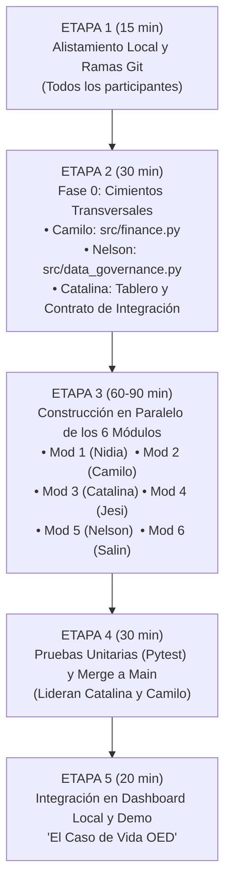

# Plan de Ejecución del Proyecto y Guía Paso a Paso por Participante — Taller Antigravity OED

> [!TIP]
> **Propósito de este Documento:**  
> Esta es la hoja de ruta operativa del taller para que **Camilo, Nidia, Nelson, Catalina, Jesi y Salin** construyan de principio a fin el software local **Asesor Financiero e Inversiones OED** usando **Antigravity**, trabajando en paralelo sin bloqueos y asegurando que los 6 módulos se integren limpiamente.

---

## 1. Mapa de Ejecución del Taller (5 Etapas)

El desarrollo se divide en **5 etapas estructuradas**. Gracias al archivo central `config/config.yaml` que ya contiene el `perfil_semilla_taller`, **ningún participante tiene que quedarse esperando a otro** durante la Etapa 3.



| Etapa | Duración Sugerida | Objetivo Principal | Entregable Verificable |
| :--- | :---: | :--- | :--- |
| **Etapa 1: Alistamiento** | 15 min | Clonar/actualizar repositorio en Antigravity, activar `.venv` y ubicarse en su rama de Git. | Entorno Python activo y ramas sincronizadas. |
| **Etapa 2: Fase 0 (Cimientos)** | 30 min | Crear/revisar el motor financiero colombiano (`src/finance.py`), la capa Habeas Data (`src/data_governance.py`) y el contrato de datos. | Funciones base de tasas ($EA \leftrightarrow EM$), UVT y cifrado listas. |
| **Etapa 3: Desarrollo Paralelo** | 60 - 90 min | Cada integrante construye y extiende su módulo en `src/` y su notebook en `notebooks/` asistido por Antigravity. | Los 6 módulos corren de forma autónoma con el perfil semilla. |
| **Etapa 4: Calidad y *Merge*** | 30 min | Ejecutar `pytest` sobre cada módulo y fusionar las 6 ramas en `main`/`master`. | Pruebas en verde y cero conflictos de *merge*. |
| **Etapa 5: Integración y Demo** | 20 min | Conectar la salida de un módulo con la entrada del siguiente y correr el caso de estudio completo. | Software integrado corriendo en local. |

---

## 2. Contrato de Integración Entre Módulos (Inputs / Outputs)

Para que las piezas encajen al final del taller, todos los módulos deben respetar estos nombres de llaves en el diccionario de estado del usuario (`perfil_usuario`):

| Módulo y Responsable | Variables que Consume (`Inputs`) | Variables que Entrega (`Outputs`) |
| :--- | :--- | :--- |
| **Transversal — Nelson**<br>`src/data_governance.py` | `usuario_id`, `autoriza_habeas_data` | `consentimiento_valido: bool`, `perfil_cifrado_path: str`, `meses_permanencia_centrales: int` |
| **Transversal — Camilo**<br>`src/finance.py` | Parámetros de `config/config.yaml` | Funciones: `ea_a_em()`, `em_a_ea()`, `calcular_tasa_real_neta()`, `calcular_vpn()`, `cuota_fija_francesa()` |
| **Módulo 1 — Nidia**<br>`src/mod1_presupuesto.py` | `modalidad_laboral`, `ingreso_bruto_mensual_cop`, `gastos_fijos_vitales_cop`, `gastos_variables_estilo_vida_cop`, `gastos_hormiga_mensual_cop` | `ingreso_neto_mensual_cop: float`, `excedente_mensual_cop: float`, `meses_fondo_emergencia: float`, `costo_oportunidad_hormiga_10a_cop: float` |
| **Módulo 6 — Salin**<br>`src/mod6_educacion_financiera.py` | Respuestas al test de riesgo, `gasto_mensual_juegos_azar_cop` | `perfil_riesgo: str` (`"Conservador"`, `"Moderado"`, `"Agresivo"`), `valor_esperado_azar_cop: float`, `alerta_piramide: bool` |
| **Módulo 3 — Catalina**<br>`src/mod3_gestion_deudas.py` | `ingreso_neto_mensual_cop`, `excedente_mensual_cop`, `lista_deudas: list[dict]` | `indice_endeudamiento_pct: float`, `estrategia_optima: str`, `ahorro_intereses_cop: float`, `flujo_caja_liberado_cop: float` |
| **Módulo 2 — Camilo**<br>`src/mod2_inversiones_salario.py` | `excedente_mensual_cop`, `perfil_riesgo`, `horizonte_meses: int` | `asignacion_portafolio: list[dict]`, `patrimonio_proyectado_real_cop: float`, `bandas_confianza_real_cop: dict` |
| **Módulo 4 — Jesi**<br>`src/mod4_finca_raiz.py` | `ingreso_familiar_neto_cop`, `valor_inmueble_cop`, `porcentaje_cuota_inicial` | `cumple_ley_546_30pct: bool`, `cuota_inicial_mensual_cop: float`, `primera_cuota_credito_cop: float`, `cap_rate_neto_pct: float`, `vpn_inmobiliario_cop: float` |
| **Módulo 5 — Nelson**<br>`src/mod5_decisiones_vida.py` | Estado consolidado (Módulos 1, 2, 3 y 4) + `tipo_decision` (`"CASARSE"`, `"HIJOS"`, `"CREDITO"`) | `vpa_decision_cop: float`, `probabilidad_exito_montecarlo_pct: float`, `dictamen_viabilidad: str`, `ahorro_mensual_requerido_cop: float` |

---

## 3. Guía Paso a Paso Individual por Participante

A continuación, cada integrante del equipo OED tiene su **guía personal de trabajo** con su rama oficial en GitHub, sus pasos numerados, las reglas colombianas que debe programar y los prompts sugeridos para usar en Antigravity.

---

### 👤 Guía 1: Camilo Matson — Matemático, Líder de Estrategia
* **Rol Transversal:** Arquitecto del Motor Matemático Colombiano (`src/finance.py`).
* **Módulo Asignado:** **Módulo 2 — Inversiones de Bajo Monto con el Salario (`src/mod2_inversiones_salario.py` y `notebooks/02_inversiones_bajo_monto_camilo.ipynb`)**.
* **Rama en GitHub:** `camilo` (`git checkout camilo && git merge main`)

#### Checklist Paso a Paso para Camilo:
- [ ] **Paso 1 (Fase 0 — 15 min): Revisar y extender `src/finance.py`.**
  * Verificar conversión exacta de tasas bajo estándar de la Superintendencia Financiera de Colombia:
    $$i_{EM} = (1 + i_{EA})^{1/12} - 1 \quad \text{y} \quad i_{EA} = (1 + i_{EM})^{12} - 1$$
  * Verificar cálculo de rentabilidad efectiva real neta descontando retención en la fuente ($4\%$ renta fija / $7\%$ variable) e inflación IPC DANE.
  * Verificar validador contra la Tasa de Usura SFC ($i_{EA} \le \text{tasa\_usura\_ea\_consumo}$).
- [ ] **Paso 2 (Módulo 2 — 25 min): Construir/Extender el Optimizador de Micro-Inversiones (`src/mod2_inversiones_salario.py`).**
  * Leer el catálogo de vehículos de bajo monto desde `config/config.yaml` (Cuentas remuneradas desde $\$10.000$, FICs desde $\$20.000$, CDTs y Acciones/ETFs en BVC desde $\$50.000$, Cuentas AFC).
  * Validar la regla de **eficiencia de costos de transacción**: si el usuario quiere comprar acciones en BVC con un aporte mensual muy pequeño donde la comisión fija ($\$14.875\text{ COP}$) supera el $1.5\%$ del aporte, recomendar acumular primero en un FIC y hacer compras trimestrales.
  * Validar la alerta de **Seguro de Depósitos Fogafín** cuando el saldo acumulado en una misma entidad supere $\$50.000.000\text{ COP}$.
- [ ] **Paso 3 (Simulación y Visualización — 20 min): Crear el Notebook y Gráfico de Abanico.**
  * Proyectar el Valor Futuro con aportes periódicos salariales ($A$) en tres bandas estocásticas ($P_{10}$ pesimista, $P_{50}$ esperada y $P_{90}$ optimista) diferenciando **Capital Aportado vs. Interés Compuesto Real**.
- [ ] **Paso 4 (Verificación):** Ejecutar `pytest` validando que $\$200.000\text{ COP}$ mensuales al $10\%\text{ EA}$ durante 120 meses proyecten el valor futuro exacto en pesos corrientes y constantes.

> **Prompt de arranque para Camilo en Antigravity:**  
> *"Hola Antigravity, soy Camilo. Basado en `src/finance.py` y `src/mod2_inversiones_salario.py`, crea el notebook interactivo `notebooks/02_inversiones_bajo_monto_camilo.ipynb` con gráficos en Plotly que muestren las bandas de confianza P10/P50/P90, el desglose entre capital aportado e interés compuesto real descontando IPC y retefuente, y la optimización tributaria con cuentas AFC."*

---

### 👤 Guía 2: Nidia Velásquez — Ingeniera Mecánica, Especialista en Presupuestos
* **Módulo Asignado:** **Módulo 1 — Presupuesto Personal e Ingeniería de Flujo de Caja (`src/mod1_presupuesto.py` y `notebooks/01_presupuesto_personal_nidia.ipynb`)**.
* **Rama en GitHub:** `NJVS` (`git checkout NJVS && git merge main`)

#### Checklist Paso a Paso para Nidia:
- [ ] **Paso 1 (Motor de Nómina Colombiana — 20 min): Liquidar Ingreso Disponible Neto ($IDN$).**
  * Revisar y personalizar en `src/mod1_presupuesto.py` las 3 modalidades contractuales de Colombia usando los topes de `config/config.yaml`:
    1. **Empleado Ordinario:** Descontar $4\%$ Salud, $4\%$ Pensión, sumar Auxilio de Transporte si gana $\le 2\text{ SMMLV}$, descontar Fondo de Solidaridad Pensional ($1\%$ a $2\%$) si gana $\ge 4\text{ SMMLV}$, y estimar Retención en la Fuente en UVT (Art. 383 E.T. con $25\%$ de renta exenta laboral).
    2. **Salario Integral ($\ge 13\text{ SMMLV}$):** Calcular cotizaciones sobre el factor base del $70\%$.
    3. **Contratista Independiente (OPS):** Calcular $\text{IBC} = 40\%$ de honorarios brutos (mínimo $1\text{ SMMLV}$) y descontar Salud ($12.5\%$), Pensión ($16\%$) y ARL Riesgo I ($0.522\%$).
- [ ] **Paso 2 (Balance Termodinámico de Caja — 25 min): Clasificar Flujos y "Fugas de Presión" (Gastos Hormiga).**
  * Calcular el balance 50/30/20 adaptado a Colombia y cuantificar las **fugas financieras** (gastos hormiga diarios/semanales + cobros de 4x1000 y cuotas de manejo).
  * Calcular el **Costo de Oportunidad a 5 y 10 años**: ¿cuánto dinero tendría hoy el usuario si esas fugas mensuales se hubieran invertido al $10\%\text{ EA}$?
- [ ] **Paso 3 (Termómetro de Emergencia y Diagrama Sankey — 20 min):**
  * Calcular los meses de cobertura del Fondo de Emergencia ($\text{Liquidez Actual} / \text{Costos Fijos Vitales}$), exigiendo 3 meses para empleados y 6 meses para independientes.
  * Generar en Plotly un **Diagrama de Sankey o Waterfall** desde el Salario Bruto hasta el `excedente_mensual_cop`.
- [ ] **Paso 4 (Verificación):** Comprobar con `pytest` que un salario bruto de $\$6.500.000\text{ COP}$ liquide correctamente el descuento de Salud, Pensión y el $1\%$ de Fondo de Solidaridad Pensional ($> 4\text{ SMMLV}$).

> **Prompt de arranque para Nidia en Antigravity:**  
> *"Hola Antigravity, soy Nidia. Usando `src/mod1_presupuesto.py`, construye el notebook `notebooks/01_presupuesto_personal_nidia.ipynb` que compare la liquidación de nómina colombiana (Empleado, Salario Integral e Independiente con IBC del 40%), grafique un diagrama Sankey en Plotly del balance de flujos y muestre el costo de oportunidad a 5 y 10 años de los gastos hormiga."*

---

### 👤 Guía 3: Nelson — Ingeniero Industrial y Actuaría, Líder de Gobierno de Datos y Datos Personales
* **Rol Transversal:** Arquitecto de Gobierno de Datos y Habeas Data (`src/data_governance.py`).
* **Módulo Asignado:** **Módulo 5 — Análisis Actuarial de Viabilidad de Decisiones de Vida (`src/mod5_decisiones_vida.py` y `notebooks/05_viabilidad_decisiones_nelson.ipynb`)**.
* **Rama en GitHub:** `nean` (`git checkout nean && git merge main`)

#### Checklist Paso a Paso para Nelson:
- [ ] **Paso 1 (Fase 0 — 15 min): Revisar y probar la Capa de Gobierno de Datos (`src/data_governance.py`).**
  * Verificar el registro de **Consentimiento Informado Local (Ley 1581 de 2012 y Decreto 1377 de 2013)** con fecha/hora y hash de integridad SHA-256.
  * Verificar las funciones de seudonimización de PII, guardado local cifrado y función de **Derecho de Supresión / Borrado Seguro**.
  * Verificar la calculadora de **Habeas Data Financiero (Ley 1266 de 2008 y Ley 2157 de 2021)**: dado un número de meses en mora, calcular el tiempo legal máximo de permanencia del reporte negativo en Datacrédito/TransUnion ($\min(2 \times \text{tiempo en mora}, 48\text{ meses})$ tras el pago).
- [ ] **Paso 2 (Módulo 5 — 30 min): Extender el Motor Actuarial de Decisiones Vitales (`src/mod5_decisiones_vida.py`).**
  * **Decisión 1 — Tener un Hijo (0 a 23 años):** Calcular el Valor Presente Actuarial ($VPA$) por etapas en Colombia (Gestación/Primera Infancia 0-4, Colegio 5-17 indexado a `inflacion_educativa_anual` del $7.5\%$, y Universidad 18-23), determinando la cuota de ahorro mensual necesaria y el capital asegurado recomendado de un **Seguro de Vida Temporal** para proteger la educación del hijo.
  * **Decisión 2 — Casarse / Unión Marital de Hecho:** Modelar el ahorro por economías de escala de vivir juntos vs. costo de boda, evaluar el impacto de **Sociedad Conyugal vs. Capitulaciones Matrimoniales**, y medir cuántos meses resiste la pareja si uno de los dos pierde su empleo.
  * **Decisión 3 — Tomar un Crédito Estructural (Posgrado o Vehículo):** Calcular el $ROI$ salarial requerido de una maestría/especialización o el Costo Total de Propiedad (*TCO*) real de un vehículo en Colombia (cuota + SOAT + impuesto vehicular + seguro todo riesgo + depreciación + gasolina/mantenimiento).
- [ ] **Paso 3 (Simulación de Monte Carlo — 20 min):**
  * Ejecutar $1.000$ trayectorias estocásticas con choques de inflación y desempleo para entregar la **Probabilidad de Solvencia ($\%$)** y el dictamen (`VIABLE_SOLVENTE`, `VIABLE_CON_AJUSTES_PREVIOS` o `RIESGO_CRITICO_APLAZAR_Y_CAPITALIZAR`).

> **Prompt de arranque para Nelson en Antigravity:**  
> *"Hola Antigravity, soy Nelson. Usando `src/data_governance.py` y `src/mod5_decisiones_vida.py`, construye el notebook `notebooks/05_viabilidad_decisiones_nelson.ipynb` que demuestre el cifrado y Habeas Data (Ley 1581/2012 y Ley 1266/2008) y grafique en Plotly las curvas actuariales y la distribución de Monte Carlo para evaluar casarse, tener un hijo (0 a 23 años) y tomar un crédito estructural."*

---

### 👤 Guía 4: Catalina Moreno — Ingeniera Industrial, Líder de Proyectos y Analítica
* **Rol Transversal:** Líder de Integración del Proyecto, Control de Calidad y Orquestación del Pipeline.
* **Módulo Asignado:** **Módulo 3 — Gestión, Administración y Optimización Analítica de Deudas (`src/mod3_gestion_deudas.py` y `notebooks/03_gestion_deudas_catalina.ipynb`)**.
* **Rama en GitHub:** `Catalina` (`git checkout Catalina && git merge main`)

#### Checklist Paso a Paso para Catalina:
- [ ] **Paso 1 (Diagnóstico y Control Legal de Pasivos — 15 min):**
  * Calcular el **Índice de Endeudamiento ($IE = \text{Cuotas Totales} / \text{Ingreso Neto}$)** con semáforo de riesgo ($<30\%$ Saludable, $30\%-40\%$ Alerta, $>40\%$ Sobreendeudamiento crítico).
  * Validar cada deuda contra la **Tasa de Usura de la SFC** vigente en `config/config.yaml` y sumar costos ocultos (seguro de vida deudor y cuota de manejo).
- [ ] **Paso 2 (Investigación de Operaciones para Desendeudamiento — 25 min):**
  * Revisar y probar el algoritmo comparativo mes a mes con efecto *roll-over* (cuando se termina de pagar una deuda, su cuota completa se suma al abono extra de la siguiente deuda):
    * **Estrategia Avalancha:** Ordena por mayor tasa efectiva anual ($EA$) total $\to$ minimiza los intereses pagados.
    * **Estrategia Bola de Nieve:** Ordena por menor saldo insoluto $\to$ maximiza la velocidad de eliminación de obligaciones.
- [ ] **Paso 3 (Simulador Ley 1328 de 2009 y Compra de Cartera — 20 min):**
  * Simular qué pasa cuando el usuario hace un **abono extraordinario a capital** (por ejemplo, con la Prima de Servicios de junio o diciembre) comparando:
    1. **Reducción de Plazo** (manteniendo la cuota igual).
    2. **Reducción de Cuota** (manteniendo el plazo igual).
  * Graficar en Plotly la curva de extinción de deuda y el **Diagrama de Gantt del Proyecto Cero Deudas**.
- [ ] **Paso 4 (Liderazgo de Proyecto):** Coordinar en la Etapa 4 la ejecución de `pytest` de los 6 módulos y el *merge* ordenado hacia la rama principal.

> **Prompt de arranque para Catalina en Antigravity:**  
> *"Hola Antigravity, soy Catalina. Usando `src/mod3_gestion_deudas.py`, crea el notebook `notebooks/03_gestion_deudas_catalina.ipynb` que diagnostique un portafolio de deudas en Colombia, compare gráficamente en Plotly el método Avalancha vs. Bola de Nieve con roll-over, simule abonos extraordinarios bajo la Ley 1328 de 2009 (reducción de plazo vs. cuota) y dibuje el cronograma Gantt de liberación de deudas."*

---

### 👤 Guía 5: Jesi — Administradora de Empresas, Magíster en Analítica
* **Módulo Asignado:** **Módulo 4 — Inversión Patrimonial en Finca Raíz Colombiana (`src/mod4_finca_raiz.py` y `notebooks/04_inversion_finca_raiz_jesi.ipynb`)**.
* **Rama en GitHub:** `Jesica` (`git checkout Jesica && git merge main`)

#### Checklist Paso a Paso para Jesi:
- [ ] **Paso 1 (Clasificación VIS/VIP vs. No VIS y Plan de Cuota Inicial sobre Planos — 20 min):**
  * Clasificar automáticamente el inmueble en **VIP ($\le 90\text{ SMMLV}$)**, **VIS ($\le 150\text{ SMMLV}$)** o **No VIS ($> 150\text{ SMMLV}$)**.
  * Modelar el flujo de pago de la **Cuota Inicial ($20\% - 30\%$)** diferida en $18$ a $36$ meses (encargo fiduciario sobre planos), integrando: ahorro mensual vía cuenta AFC, cesantías anuales, primas y subsidio de Caja de Compensación Familiar (si aplica para ingresos $\le 4\text{ SMMLV}$).
- [ ] **Paso 2 (Simulador Ley 546 de 1999: Crédito en Pesos vs. UVR — 25 min):**
  * Validar la regla de oro de la **Ley 546 de 1999**: verificar que la primera cuota del crédito no supere el **$30\%$ del ingreso familiar mensual**; si lo supera, calcular automáticamente cuánto ingreso adicional o cuánta cuota inicial extra necesita el usuario.
  * Simular y comparar la evolución del crédito en **Pesos Cuota Fija** frente a **UVR (Unidad de Valor Real indexada al IPC DANE)**, mostrando cómo evoluciona la cuota en pesos cuando la inflación sube.
- [ ] **Paso 3 (Analítica de Inversión Inmobiliaria: *Cap Rate*, $VPN$, $TIR$ y Ley 820 de 2003 — 20 min):**
  * Calcular los costos reales de cierre y tenencia en Colombia: gastos notariales/beneficencia/registro ($\approx 3\%$), impuesto predial, administración, vacancia, mantenimiento y tope legal del canon de arriendo (**Ley 820 de 2003**: máximo $1\%$ mensual del valor comercial).
  * Calcular **Cap Rate Neto**, **$VPN$** y **$TIR$**, comparando la compra física frente a invertir el mismo capital en un portafolio financiero/FIC Inmobiliario.

> **Prompt de arranque para Jesi en Antigravity:**  
> *"Hola Antigravity, soy Jesi. Usando `src/mod4_finca_raiz.py`, construye el notebook `notebooks/04_inversion_finca_raiz_jesi.ipynb` para evaluar inversión inmobiliaria en Colombia (VIS/VIP vs. No VIS, plan de cuota inicial sobre planos con cesantías y AFC, validación del tope del 30% de la Ley 546 de 1999, comparativa gráfica Pesos vs. UVR en Plotly, y cálculo de Cap Rate Neto, VPN y TIR bajo la Ley 820 de 2003)."*

---

### 👤 Guía 6: Salin Avellaneda — Matemático, Líder de Rifas, Juegos y Espectáculos
* **Módulo Asignado:** **Módulo 6 — Educación Financiera Interactiva, Psicología del Riesgo y Probabilidad Aplicada (`src/mod6_educacion_financiera.py` y `notebooks/06_educacion_probabilidad_salin.ipynb`)**.
* **Rama en GitHub:** `SEAP` (`git checkout SEAP && git merge main`)

#### Checklist Paso a Paso para Salin:
- [ ] **Paso 1 (Perfilador Regulatorio de Riesgo SFC — Decreto 2555 de 2010 — 20 min):**
  * Implementar el cuestionario cuantitativo y conductual que evalúa horizonte de tiempo, estabilidad laboral, conocimiento financiero y tolerancia a pérdidas para clasificar al usuario en **`Conservador`**, **`Moderado`** o **`Agresivo`**.
  * Programar el **detector de inconsistencia conductual**: si el usuario busca altísima rentabilidad pero declara pánico ante una caída del $5\%$, ajustar su perfil para proteger su idoneidad (*Suitability*).
- [ ] **Paso 2 (Laboratorio Matemático "Juegos de Azar vs. Inversión Compuesta" — 25 min):**
  * Modelar la probabilidad combinatoria exacta y el **Valor Esperado ($E[X]$)** de juegos de suerte y azar populares en Colombia:
    * **Lotería / Baloto:** Probabilidad combinatoria $\frac{1}{\binom{43}{5} \times 16} = \frac{1}{15.401.568}$.
    * **Chance de 4 cifras:** Probabilidad $\frac{1}{10.000}$ y retorno esperado negativo para el apostador tras impuestos.
  * Simular y graficar durante 10 años qué ocurre con $\$200.000\text{ COP}$ mensuales destinados a apuestas recreativas ($E[X] < 0$) frente a invertir esos mismos $\$200.000\text{ COP}$ mensuales con interés compuesto en el Módulo 2.
- [ ] **Paso 3 (Detector Matemático de Pirámides y Captación Ilegal — Art. 316 Código Penal — 15 min):**
  * Evaluar una promesa de rentabilidad sospechosa (ej. *"10% mensual fijo sin riesgo"*) y calcular mediante progresión geométrica ($N_k = r^k$) en cuántos ciclos el esquema supera la población adulta de Colombia y colapsa matemáticamente, generando alerta pedagógica de la SFC.

> **Prompt de arranque para Salin en Antigravity:**  
> *"Hola Antigravity, soy Salin. Usando `src/mod6_educacion_financiera.py`, construye el notebook `notebooks/06_educacion_probabilidad_salin.ipynb` con el test de perfil de riesgo del Decreto 2555 de 2010, gráficos interactivos en Plotly que comparen el Valor Esperado E[X] de loterías/chance/apuestas frente al interés compuesto en Colombia, y la visualización del colapso geométrico de pirámides (Art. 316 del Código Penal)."*

---

## 4. Protocolo de Trabajo Colaborativo en Git y Antigravity

Cada participante ya cuenta con su rama en el repositorio remoto `https://github.com/camilomath/asesor_inversiones_oed.git`:
* **Camilo:** rama `camilo`
* **Nidia:** rama `NJVS`
* **Nelson:** rama `nean`
* **Catalina:** rama `Catalina`
* **Jesi:** rama `Jesica`
* **Salin:** rama `SEAP`

### Secuencia de Comandos por Participante Durante el Taller:
```powershell
# 1. Traer los últimos cambios del repositorio y ubicarse en su rama personal:
git fetch origin
git checkout <TU_RAMA>
git merge origin/main

# 2. Ejecutar las pruebas unitarias de los 6 módulos:
pytest tests/

# 3. Guardar y subir los avances de su módulo y notebook:
git add src/ notebooks/ tests/
git commit -m "feat(oed): avance de modulo en taller antigravity"
git push origin <TU_RAMA>
```

---

## 5. Caso de Prueba Maestro para la Demo Final ("El Caso OED")

En la **Etapa 5**, el equipo probará el software completo con este caso integrado de principio a fin:

1. **Entrada en Módulo 6 (Salin):** La usuaria de prueba responde el test de riesgo SFC $\to$ obtiene perfil **`Moderado`** y descubre que los $\$200.000\text{ COP}$/mes que gastaba en rifas y apuestas pueden convertirse en más de $\$40.000.000\text{ COP}$ en 10 años con interés compuesto.
2. **Paso al Módulo 1 (Nidia):** Ingresa un salario bruto de empleado por **$\$6.500.000\text{ COP}$** $\to$ el módulo liquida Salud, Pensión y FSP, detecta $\$320.000\text{ COP}$ en gastos hormiga y calcula su excedente mensual disponible.
3. **Paso al Módulo 3 (Catalina):** Registra una tarjeta de crédito al $25.5\%\text{ EA}$ y un crédito de libre inversión al $16.5\%\text{ EA}$ $\to$ el algoritmo **Avalancha** maximiza el ahorro en intereses y libera flujo de caja.
4. **Paso al Módulo 2 (Camilo):** Con el flujo liberado y su perfil `Moderado`, estructura un portafolio mensual entre Bolsillo Remunerado, CDT Digital, FIC Balanceado y Cuenta AFC.
5. **Paso al Módulo 4 (Jesi):** Evalúa comprar un apartamento de **$200\text{ millones COP}$ (VIS)** sobre planos a 24 meses $\to$ verifica que la cuota cumple el tope del **$30\%$ de la Ley 546 de 1999** y compara Pesos Fijos vs. UVR.
6. **Cierre en Módulo 5 (Nelson):** Con el consentimiento de la **Ley 1581 de 2012** activo, simula en **Monte Carlo ($1.000$ escenarios)** la viabilidad actuarial de **Casarse y Tener un Hijo** sin poner en riesgo el pago de la vivienda ni su retiro.
